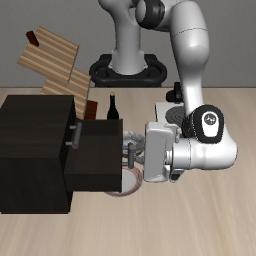

# ORA 单任务复现：机械臂开抽屉

**DeepSeek Flash 打开了中层抽屉（1/1）；同场景的合法随机指令没打开（0/3）。** 这次轨迹最有意思的是：抓取规划器没给出候选，模型自己选了把手、接近方向和拉动目标，并在腕部相机提供新测量后修正了抓取位置。感知测量、IK、轨迹与底层执行仍由工具完成。

[看成功录像](media/open-middle-drawer.mp4) · [读模型动作追踪](reports/model-role.md) · [复现步骤](REPRODUCE.md)



## 结果

2026-11-07，LIBERO `libero_goal/0`、环境 seed 0；仿真与工具运行在课题组服务器的一张 RTX 4090 上。成功以 LIBERO 官方判定为准，四个回合均为有效样本。

| 策略 | 官方成功 | 机器人决策 | 仿真步 | 模型调用 | 真实耗时 |
|---|---:|---:|---:|---:|---:|
| [DeepSeek Flash](reports/ora-single-episode.md) | 是 | 7 | 498 | 16 | 388.74 秒 |
| [随机 20261107](media/random-20261107.mp4) | 否 | 80 | 1372 | 0 | 172.58 秒 |
| [随机 20261108](media/random-20261108.mp4) | 否 | 80 | 1499 | 0 | 162.00 秒 |
| [随机 20261109](media/random-20261109.mp4) | 否 | 80 | 1437 | 0 | 172.51 秒 |

视频来自原始仿真画面，省略模型与工具等待。DeepSeek 回合加四次预检按当时闲时公开价折算约 **¥0.37**；随机对照未调用模型。随机策略不看图、不使用目标坐标，检验的是盲发合法指令能否完成任务；它不是手写视觉策略基线。

## 报告与证据

- [DeepSeek 复现记录](reports/ora-single-episode.md)：环境、版本、用量与首次成功边界。
- [随机对照](reports/random-control.md) · [工具源码审计](reports/tool-audit.md)：采样协议、预算和工具的实际职责。
- [模型角色](reports/model-role.md) · [16 轮可见输出](reports/visible-turns.md) · [完整工具调用与执行追踪](evidence/deepseek/tool-to-action-trace.json)。
- [RoboHarness V2 对比与可行性](reports/roboharness-v2.md)：另一个项目的源码考察，没有运行 RoboHarness 回合。

运行记录在 [evidence/](evidence/)。公开副本已替换机器路径、移除瞬时服务绑定；包含可见模型输出及结构化调用，不包含原始 API 请求、凭据或推理正文。仿真和预训练权重请从各上游获取。原始证据字段里的摘要值保留为来源元数据，不用于证明公开导出是原文件的逐字节副本。

```bash
python3 scripts/verify.py
```

该检查只读取归档，核对原生判定、动作追踪与全部 600 个预生成随机提议；不需要 GPU 或模型账户。参见[上游与媒体来源](THIRD_PARTY_NOTICES.md)。
